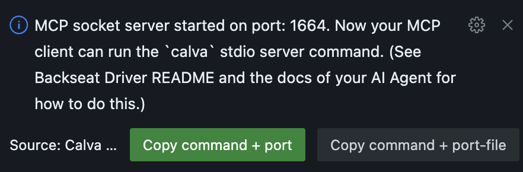

# Configure Backseat Driver as an MCP Server

If you are using Backseat Driver with harnesses _other than_ Copilot, [Cursor](https://www.cursor.com/), or [ECA](https://eca.dev/), you'll need to configure an MCP server.

## How it works

Backseat Driver runs a socket server inside the VS Code Extension Host. Your MCP client starts a small Node **stdio wrapper** that connects to that socket (port number, or the path from **Copy command** / `bb list`).

There is one Backseat Driver MCP server per VS Code window. Change the preferred port with `calva-backseat-driver.mcpSocketServerPort`. Use `0` (default) to always pick a random available port.

While the socket is running, Backseat Driver also writes a live JSON entry to `~/.config/vscode-mcp/registry/windows/calva-backseat-driver-<window-id>.json` (when `calva-backseat-driver.enableMcpRegistry` is `true`, the default). External agents (bots, phone clients, other machines that can see that home directory) can scan the folder, treat an entry as live when its `pid` is still running and `updatedAt` is less than 60 seconds old, then attach with:

```
node <mcp.wrapperPath> <mcp.portFilePath> <mcp.host>
```

`sessions` on the entry is compact (`replSessionKey`, absolute `projectRoot`, `globs`, and a short runtime summary). Query full Shadow-cljs runtimes via MCP after you attach.

## What you need to do

With your project opened in VS Code (or fork):

1. Start the Calva MCP socket server (**Calva Backseat Driver: Start the MCP socket server**), or configure the MCP server to auto-start. Backseat Driver will:
   * Create the port file
   * Show a confirmation dialog offering a button: **Copy command + port** or **Copy command + port-file** for your MCP client config

     
2. Add the MCP server in your client (steps vary by client)

## Configuration

How you configure it depends on where the agent runs. (Or hand your agent the registry folder, `~/.config/vscode-mcp/registry`, and ask it to set the MCP server up.)

* **Agent running in a VS Code window** (an extension in the window, or a CLI in one of its terminals): put only the wrapper in the harness's user-level config, `node ~/.config/calva/backseat-driver/calva-mcp-server.js`. With no port file, the wrapper connects to the window the agent runs in, so the same config works in every window.
* **Agent outside VS Code:** name the window with its port file, `node <wrapper path> <port file path> <host>`. Use **Copy command + port-file** from the start dialog, or `bb list --all` under `~/.config/vscode-mcp/registry`.

  NB: The port-file path ends in a window id. The id comes from the editor (VS Code, Insiders, Cursor, …) plus the `.code-workspace` file you opened, or the folder when you opened a folder. Open the same project in another editor, or through another workspace file, and you get a different port file. If the client stops connecting, copy the path again from the window you're in.

### Cursor

No config needed for Cursor. Backseat Driver handles this for you, Zero Conf, the MCP server will be named `extension-backseat-driver`. If for some reason you need to configure this manually, you can disable the automatic Cursor config and MCP connect by settting `autoRegisterCursorMcp` to `false`. 

### ECA

No config needed when the ECA extension is installed and a workspace is open. Backseat Driver upserts project-local `.eca/config.json` (server key `calva-backseat-driver`) in the first workspace folder each time the server starts, so it points at the window that started last. Opt out with `calva-backseat-driver.autoRegisterEcaMcp` set to `false`. Stop does not remove the ECA entry. No Register-with-ECA command.

### Claude Code

Add the server to your user-level config, once:

```sh
claude mcp add --scope user backseat-driver -- node ~/.config/calva/backseat-driver/calva-mcp-server.js
```

Claude Code doesn't give the agent an MCP server's skills as skills. When it connects, the agent offers to link Backseat Driver's skills into `~/.claude/skills/`. For the Clojure skill and the editing subagents, install the `clojure` and `clojure-editor` plugins from [Awesome Backseat Driver](https://github.com/BetterThanTomorrow/awesome-backseat-driver):

```
/plugin install clojure --marketplace BetterThanTomorrow/awesome-backseat-driver
/plugin install clojure-editor --marketplace BetterThanTomorrow/awesome-backseat-driver
```

### Windsurf configuration

Please help with providing info here.

### Claude desktop

Claude Desktop doesn't run in VS Code and has no project/workspace concept, so use its global MCP config. The app can open that file for you. Prefer **Copy command + port-file** or `bb list` for the args.

```json
{
  "mcpServers": {
    "backseat-driver": {
      "command": "node",
      "args": [
        "<absolute path to calva-mcp-server.js>",
        "<port file path from Copy command or bb list>"
      ]
    }
  }
}
```

### Antigravity

Please help with providing info here.

### Other MCP client?

Please add configuration for other AI clients! 🙏

Cursor auto-registration works without a workspace folder. When auto-registration is enabled, a random port is used (the configured static port is respected only when auto-registration is disabled).
